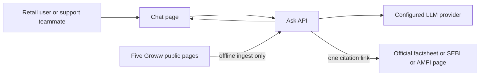
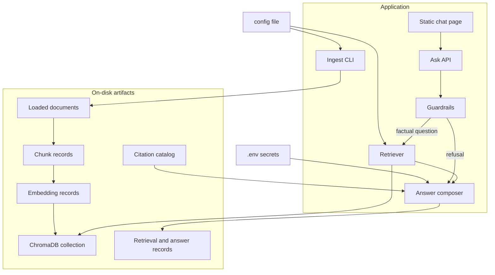
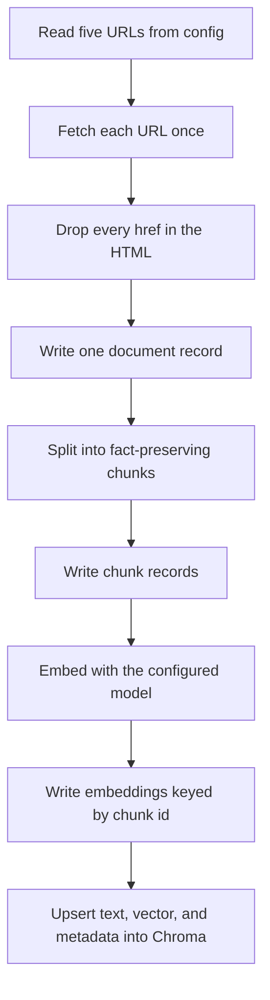
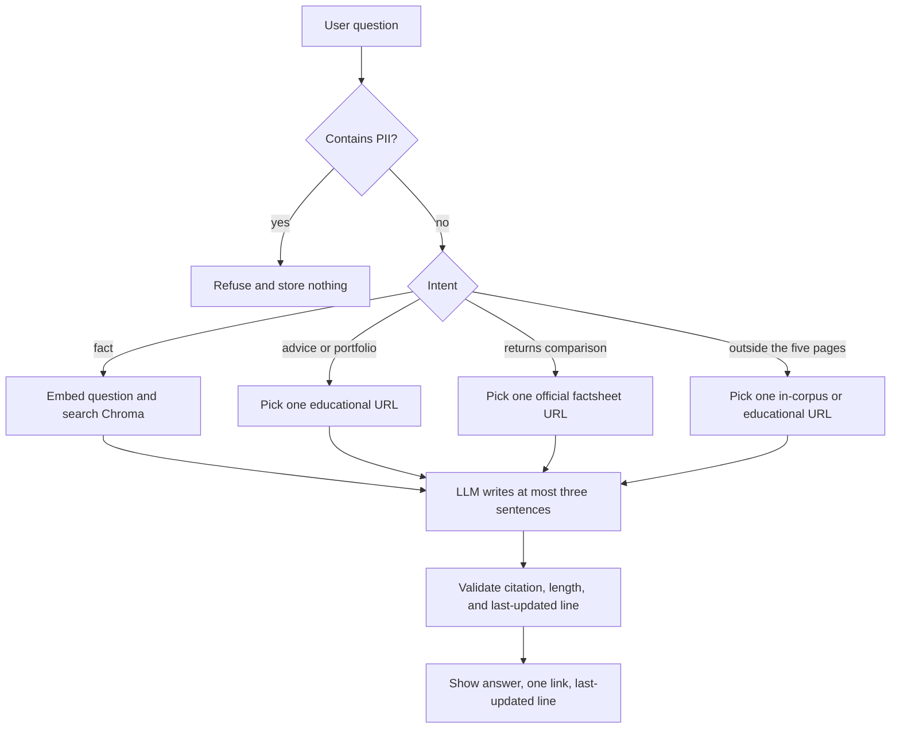

# Architecture: HDFC Mutual Fund Facts Assistant

**Source:** `PRD.md`  
**Status:** Draft

This document describes how the prototype is structured. It does not describe setup commands or deploy clicks.

## 1. Architecture decisions

| Decision | Choice | Why |
| --- | --- | --- |
| Runtime | Python application | ChromaDB and `sentence-transformers` are native to Python. One process can run ingest and the ask API. |
| Serving | HTTP API plus one static chat page | The UI is a small page. Ingest stays offline so a question never triggers a scrape. |
| Corpus boundary | Allowlist of five URLs in config | The loader can only fetch URLs in that list. Links found in HTML are ignored. |
| Citation boundary | A separate citation catalog | Answers may cite an official factsheet or an SEBI/AMFI educational page that was never scraped. Those URLs are not ingest targets. |
| Embeddings | One local model for ingest and query | `sentence-transformers/all-MiniLM-L6-v2`, name read from config. |
| Vector store | ChromaDB, persistent on disk | Required for this exercise. Path and collection name come from config. |
| LLM | Provider interface, Groq by default | Gemini, OpenAI, Anthropic, and Mistral are alternate implementations. Model id and API keys come from `.env`. |
| Stage visibility | Each pipeline stage writes files | A reviewer can open load, chunk, embed, retrieve, and answer artifacts without querying Chroma first. |
| PII | Reject before embed, retrieve, or log | A message with personal data never becomes a vector, a retrieval record, or an answer sample. |

## 2. System context



The user never talks to Groww, the LLM, or ChromaDB directly. The chat page calls the ask API. Ingest reads the five pages on a schedule the operator runs, not on each question.

## 3. Containers



| Container | Responsibility |
| --- | --- |
| Ingest CLI | Run load, chunk, embed, and store. Write each stage to disk. Do not serve user traffic. |
| Ask API | Accept one question, run guardrails, retrieve when allowed, call the LLM, validate the answer, return it. |
| Chat page | Welcome line, three example questions, disclaimer, and the answer with one link. |
| Config | Non-secret settings: allowlist, model name, Chroma path, chunk limits, top-k, citation catalog. |
| `.env` | `LLM_PROVIDER`, `LLM_MODEL`, and the provider API key. Never committed. |

## 4. Ingest flow

Ingest is idempotent. A later run replaces documents and chunks for the same URL. Chroma upserts by chunk id. A failed fetch of one page does not delete the previous successful copy of that page.



### 4.1 Load

- Input is the allowlist, not the page graph.
- The fetcher requests a URL only after an exact string match against the allowlist.
- HTML is converted to text. Script, style, and navigation chrome are dropped.
- Anchor tags contribute no further requests.
- Each document record contains: `doc_id`, `url`, `title`, `text`, `fetched_at`.
- `fetched_at` is the source date printed as `Last updated from sources:`.

### 4.2 Chunk

These pages are labeled fact sheets: expense ratio, exit load, minimum SIP, riskometer, benchmark, lock-in, tax, and statement steps sit under headings.

Chunking strategy:

1. Split on headings and on those known labels so a label and its value stay in the same chunk.
2. Keep a short section as one chunk.
3. If a section exceeds the configured maximum, split it on paragraph boundaries and repeat the section title on each piece.
4. Do not use a fixed character window as the primary split. That would separate a label from its value.

Each chunk record contains: `chunk_id`, `doc_id`, `url`, `title`, `section`, `text`, `fetched_at`.

`chunk_id` is stable for a given URL plus section plus piece index, so a re-ingest updates the same Chroma rows.

### 4.3 Embed

- Model id is read from config. Default: `sentence-transformers/all-MiniLM-L6-v2`.
- The same id is used when a question is embedded.
- The stage writes one vector per `chunk_id` so embeddings can be inspected before opening Chroma.

### 4.4 Store

ChromaDB persistent client. Collection name and path come from config.

Each row stores:

| Field | Value |
| --- | --- |
| id | `chunk_id` |
| document | chunk text |
| embedding | vector from stage 3 |
| metadata.url | parent page URL, used as the citation |
| metadata.title | page or scheme name |
| metadata.section | heading or label |
| metadata.fetched_at | load timestamp |

After upsert, a check compares chunk ids on disk with ids in the collection and records any missing id. That check is how “are all the chunks in the vector DB?” is answered.

## 5. Request flow



PII detection runs first. On a match, the API returns a polite refusal with one educational link and does not embed the text, write a retrieval record, or put the value in Chroma, logs, or the sample Q&A file.

Intent routing decides answer versus refuse before the model sees retrieved facts:

| Intent | Retrieval | Citation |
| --- | --- | --- |
| Factual, in scope | Top-k chunks from Chroma | The `metadata.url` of the chunk that states the fact. One URL only. |
| Advice or portfolio (“Should I buy or sell?”, “Which is better?”) | None | One SEBI or AMFI educational page from the catalog. |
| Performance comparison or “calculate my returns” | None | One official factsheet URL from the catalog. No ranking and no new arithmetic. |
| Named scheme or AMC outside the five pages | None | One in-corpus page or one educational page. The reply says it is out of scope. |
| Factual, but no chunk supports it | Retrieval happened and was insufficient | The closest in-corpus page. The reply says the fact is not in the loaded sources. |

A labeled figure that already appears on a loaded page may be quoted when the user asks for that figure. The composer must not subtract, annualize, rank, or recommend from it.

### 5.1 Retrieval

- Embed the question with the ingest model.
- Query the ingest collection.
- Persist the question, chunk ids, scores, and source URLs in the retrieval artifact. This happens only after the PII check has passed.
- Pass chunk text and the allowed citation URLs to the composer. The model may not introduce a URL that is absent from that set.

### 5.2 Answer composer

The LLM call uses one system prompt that requires:

- Identify the fact asked, or say the question is outside facts-only scope.
- Use only the supplied chunk text for factual claims. Do not fill gaps from model memory.
- At most three sentences.
- Exactly one URL, copied from the allowed set.
- No buy, sell, hold, allocation, or “best fund” language.
- End with `Last updated from sources: <fetched_at of the cited page>`.

A deterministic check runs after the model returns. It rejects the draft when any of these fail:

- More than three sentences.
- URL count is not one.
- The URL is not in the allowed set for that intent.
- The last-updated line is missing.
- The draft recommends a transaction or ranks performance when the intent forbids it.

On rejection, the API returns a fixed template that still obeys the contract: one sentence stating the outcome, one allowed link, and the last-updated line. If the provider itself errors, the same template is used. The user still receives a citation.

### 5.3 Provider interface

```text
complete(system_prompt, user_prompt) -> text
```

| Provider | Selected when `LLM_PROVIDER` is |
| --- | --- |
| Groq | `groq` (default) |
| Gemini | `gemini` |
| OpenAI | `openai` |
| Anthropic | `anthropic` |
| Mistral | `mistral` |

`LLM_MODEL` is the model id string sent to that provider. The brief’s Groq example is `qwen/qwen3.8-27b`; the process uses the `.env` value so a wrong id can be replaced without a code change.

Only the selected provider’s key is required at runtime.

## 6. Chat page

One page. No login and no inputs intended for personal data.

| Region | Content |
| --- | --- |
| Header | Assistant name and scope: HDFC Mutual Fund facts for the AMC overview and the Large Cap, Flexi Cap, ELSS, and Mid Cap direct-growth schemes. |
| Disclaimer | Persistent text: “Facts-only. No investment advice.” The same string is the disclaimer deliverable. |
| Examples | Three factual prompts: expense ratio, ELSS lock-in, minimum SIP. Choosing one sends that question. |
| Transcript | User text, then the answer, one citation link, and the last-updated line. |
| Composer | A single question box and a send control. |

Visual direction: light background, dark text, Groww’s public green as the accent. Colors are design tokens on the page, not hardcoded business logic.

The page talks only to `POST /ask` with `{ "question": "..." }` and renders `{ "answer", "citation_url", "last_updated", "refused" }`.

## 7. Data contracts

### 7.1 Document

```text
doc_id, url, title, text, fetched_at
```

One file per allowlisted URL.

### 7.2 Chunk

```text
chunk_id, doc_id, url, title, section, text, fetched_at
```

### 7.3 Embedding record

```text
chunk_id, model, dimension, vector
```

### 7.4 Citation catalog entry

```text
url, kind, title
```

`kind` is `corpus`, `factsheet`, or `educational`.

- `corpus` entries are exactly the five ingest URLs.
- `factsheet` and `educational` entries are citation-only. They bring the submitted source list to 15–25 official URLs. They are never fetched by the loader.

### 7.5 Ask response

```text
answer, citation_url, last_updated, refused
```

`refused` is true for PII, advice, performance comparison, and out-of-scope questions.

## 8. Configuration

Non-secret file (name fixed in implementation, values changeable):

| Key | Role |
| --- | --- |
| `sources` | The five URLs. The only fetch allowlist. |
| `citation_catalog` | Corpus, factsheet, and educational URLs. |
| `embedding.model` | Default `sentence-transformers/all-MiniLM-L6-v2`. |
| `chroma.path` | Persistent directory. |
| `chroma.collection` | Collection name. |
| `chunk.max_chars` | Threshold before a section is split again. |
| `retrieval.top_k` | How many chunks are sent to the composer. |

`.env` keys, with empty values in `.env.example`:

| Key | Role |
| --- | --- |
| `LLM_PROVIDER` | `groq`, `gemini`, `openai`, `anthropic`, or `mistral`. |
| `LLM_MODEL` | Model id for that provider. |
| `GROQ_API_KEY` | Used when the provider is Groq. |
| `GEMINI_API_KEY` | Used when the provider is Gemini. |
| `OPENAI_API_KEY` | Used when the provider is OpenAI. |
| `ANTHROPIC_API_KEY` | Used when the provider is Anthropic. |
| `MISTRAL_API_KEY` | Used when the provider is Mistral. |

Changing model, database path, or LLM id does not require editing stage logic.

## 9. Where artifacts live

| Path role | Contents |
| --- | --- |
| Loaded documents | One record per page, including `fetched_at`. |
| Chunks | All chunk records after a run. |
| Embeddings | Vectors aligned to `chunk_id`. |
| Chroma directory | The collection. Git ignores this directory. |
| Retrieval records | Non-PII questions only: chunk ids, scores, URLs. |
| Answer records | Final text and the single citation, for the sample Q&A file. |
| Disclaimer file | The exact UI sentence. |
| Source list | The 15–25 URL catalog exported as Markdown or CSV. |

PII refusals leave no question text in any of these paths.

## 10. Trust boundaries

| Boundary | Rule |
| --- | --- |
| Loader | Fetch allowlist only. No in-page links. No third-party blogs. No app back-end screenshots. |
| Vector store | Chunks from the five pages only. User text is never upserted. |
| LLM | Sees retrieved chunks or a refusal instruction. It does not choose URLs freely. |
| Logs and samples | No PAN, Aadhaar, account number, OTP, email, or phone number. |
| UI | No account, statement download, or identifier fields. Statement questions are answered only as public how-to text from the corpus. |

## 11. Failure behavior

| Failure | Behavior |
| --- | --- |
| One allowlisted page fails to load | Keep the previous document and its chunks. Surface the error in the ingest result. |
| Chroma is missing or empty | The API says sources are not loaded yet. It does not invent facts. |
| Provider or model id is invalid | Return the template answer with one catalog link. Do not print the API key. |
| Model draft fails the answer check | Replace it with the template that still has one link and the last-updated line. |
| Question contains PII | Refusal citation only. Drop the question body. |
